<p align="center">
  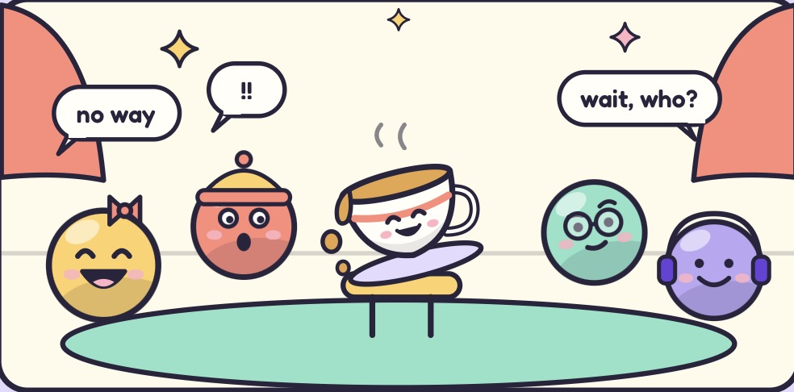
</p>

<p align="center">
  <b>Late to the call? We'll spill it!</b><br>
  A voice room for friends telling stories. Join late and you hear a 20-second spoken recap of what you missed,<br>
  and when old gossip comes back, a story card pops up before the sentence is even finished.
</p>

<p align="center">
  <a href="https://spill-the-tea-call.vercel.app"></a>
  
  
  
  
  
  
</p>

<p align="center">
  <a href="#see-it-work">Demo</a> ·
  <a href="#how-it-works">How it works</a> ·
  <a href="#design-decisions">Design decisions</a> ·
  <a href="#architecture">Architecture</a> ·
  <a href="#what-we-measured">Results</a> ·
  <a href="#run-it">Run it</a>
</p>

> [!IMPORTANT]
> Spill the Tea is a hackathon prototype built at Cal Hacks 13.0. It has only been tested by the team, on the team's own phones.

## Why

You can scroll back a chat. You can't scroll back a conversation.

Our friend group is spread across cities and time zones, so someone always joins the call late. By then the others are deep into a story about Kevin, and every callback ("he did it again", "remember the airport thing?") points to something the latecomer never heard. They can interrupt and stop the story, or stay quiet and never really join in. Spill the Tea gives them the missing context back by voice, in the same medium they missed it in, without anyone stopping the story. When the night is over, the tea gets poured out and nothing is kept.

## See it work

<p align="center">
  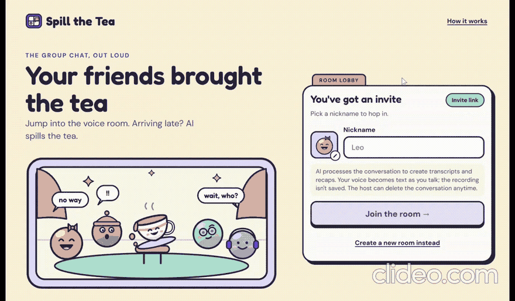
</p>

<sub>Recorded from a live room in the app, with real Claude and Cartesia output, sped up.</sub>

Try it yourself: [spill-the-tea-call.vercel.app](https://spill-the-tea-call.vercel.app), opened on two or more phones.

## How it works

Everyone joins an always-on call from their own phone, with no push-to-talk, and friends see your words appear while you're still talking.

<table>
  <tr>
    <td width="35%" align="center">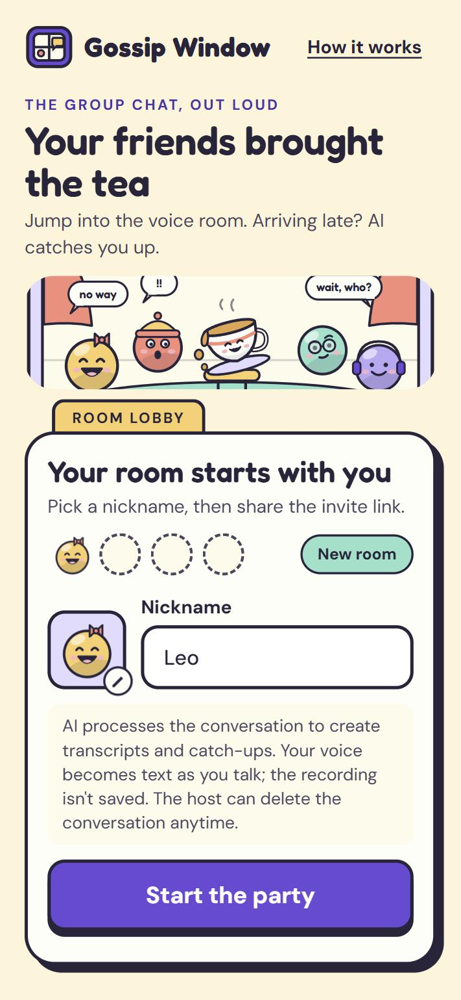</td>
    <td width="65%" align="center">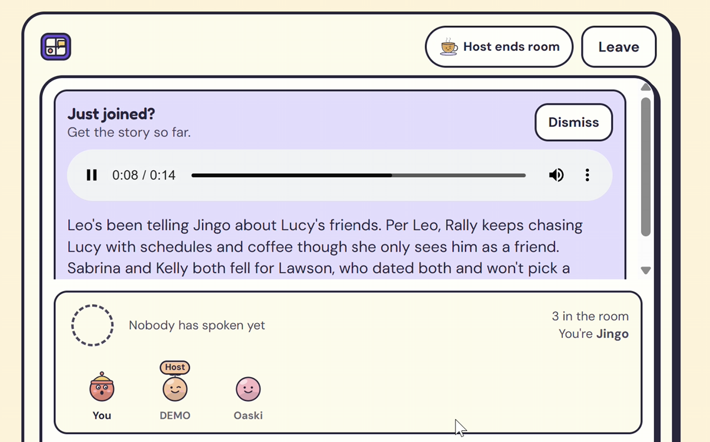</td>
  </tr>
  <tr>
    <td valign="top"><b>1. Pour a cup.</b> The host starts a room and shares an invite link or QR code. Everyone is told on entry that the call is transcribed, and a red dot on Mute shows whenever the mic is live.</td>
    <td valign="top"><b>2. Join late, hear the recap.</b> A latecomer gets a <i>Just joined?</i> panel with a 20-second "previously on…" of only what they missed, read by a neutral narrator on their phone only. Friends keep talking, and their voices drop to 30% while it plays.</td>
  </tr>
</table>

### 3. Recall, mid-sentence

When someone mentions a person or story you missed, the backstory pops up before the sentence is even finished. The phone matches Ink's streaming text against the people and stories it already knows, so there's no extra AI call. Tap a story to see what happened as the teller told it, with friends' real reactions in their own words and whether it came up before or after you joined.

<p align="center">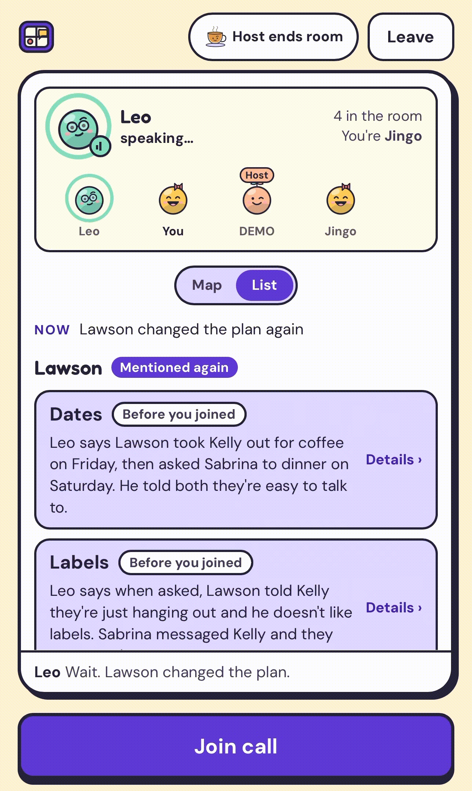</p>

### 4. The whole cast at a glance

Everyone shares a live recall board: who's being talked about, their stories in a line or two, and what the group is on now. Switch it from **List** to **Map** for a web of everyone mentioned. It grows as new names come up.

<table>
  <tr>
    <td width="50%" align="center">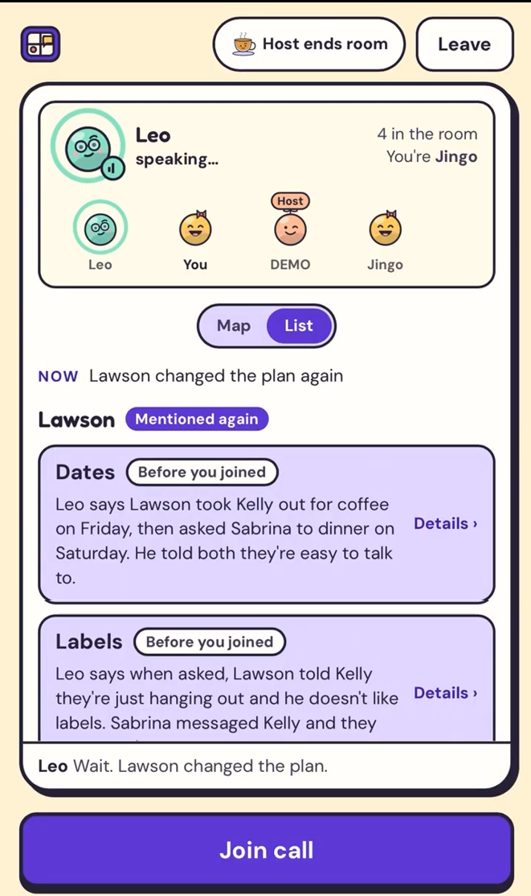</td>
    <td width="50%" align="center">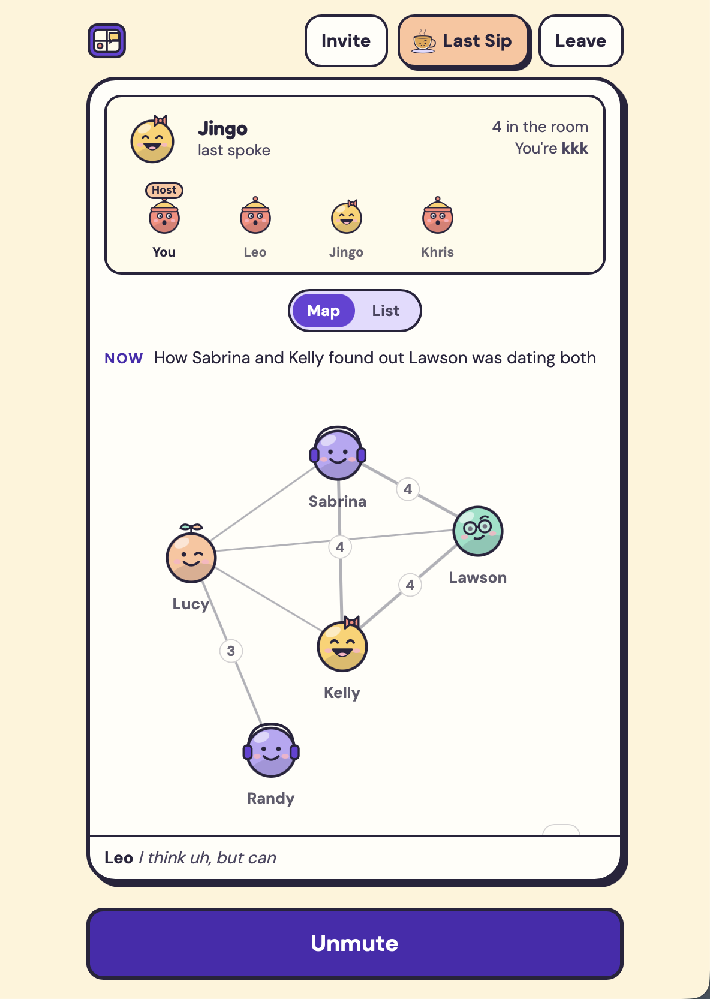</td>
  </tr>
  <tr>
    <td valign="top"><b>List.</b> Each person with their stories, newest first, and a tag when someone is mentioned again.</td>
    <td valign="top"><b>Map.</b> Each <b>icon</b> is a person being talked about. Each <b>line</b> is a relationship between two people who show up in the same stories. Thicker lines and the number on them mean more shared stories.</td>
  </tr>
</table>

Tap the Map to dig in:

<table>
  <tr>
    <td width="50%" align="center">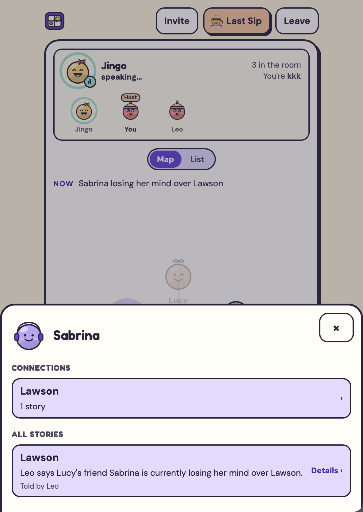</td>
    <td width="50%" align="center">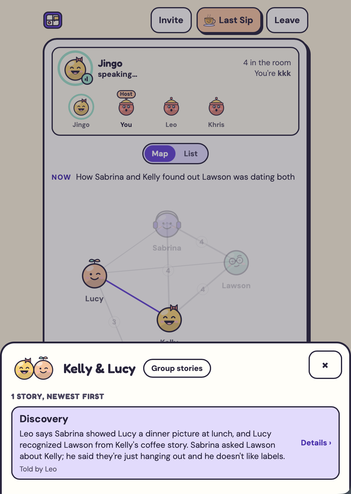</td>
  </tr>
  <tr>
    <td valign="top"><b>Tap a person</b> to see that person's own stories, and who they're connected to.</td>
    <td valign="top"><b>Tap a line</b> to see the relationship: the stories the two people share, newest first.</td>
  </tr>
</table>

### 5. Last Sip

The host ends the room and a teacup tips over and pours out its tea. The call ends for everyone, and the transcript, stories and recap audio are deleted. What's said over tea stays over tea.

<p align="center">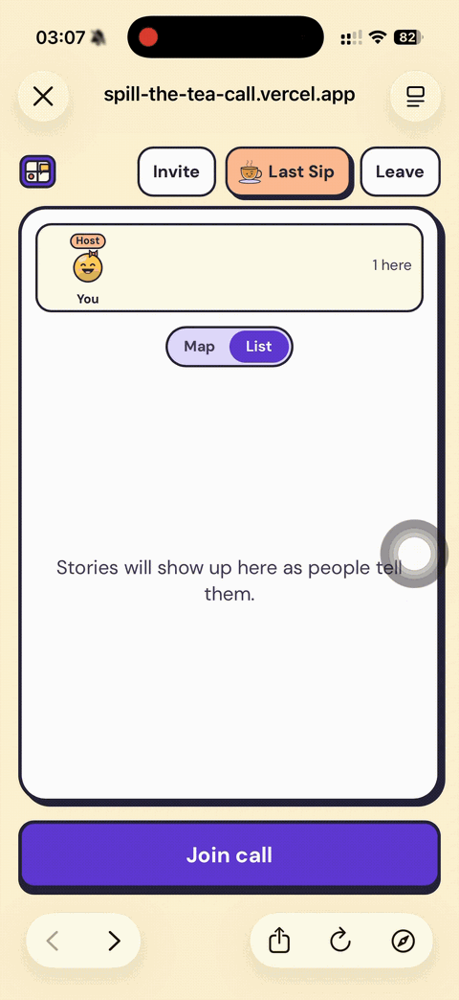</p>

## Design decisions

- **Better silent than wrong.** Claude doesn't score its own confidence. It answers plain questions (was the person named, or only "he"? does more than one person fit?) and fixed rules turn the answers into a score: a name or alias is 0.95, a story reference 0.9, a pronoun 0.8. Ambiguous matches score 0.5, below the 0.7 needed to show a pop-up.
- **Two Kevins are two people.** "Not that Kevin, Kevin from work" keeps them apart. The eval replays the conversation and checks the two are never merged.
- **Stories stay the teller's account.** "Alex says Kevin ate the whole cake", never stated as fact. Guesses are labeled as speculation, reactions are real quotes credited by name, and every story links back to the lines it came from.
- **No mind reading.** Claude never guesses how anyone feels from silence.
- **Words are data.** Anything said on the call is treated as transcript, never as instructions to the AI.
- **Two speeds of AI.** A late pop-up is useless and a wrong one is worse, so Haiku checks every line for a callback while Sonnet rebuilds the people and stories in the background, about every 25 s.
- **The recap never enters the call.** The narrator plays locally on the latecomer's phone, so friends don't hear it, and their voices are ducked while it plays.
- **Every phone hears every voice.** An open mic in a busy room picks up everyone, so we stacked Krisp's background-voice cancellation, a loudness gate that learns the owner's speaking level, and a stricter turn start inside Ink (`turn_start_threshold` 0.8).
- **Interruptions keep their order.** When a friend's line lands while my turn is still open, a turn splitter cuts my turn there, so the transcript keeps the real order.
- **Nothing kept.** Raw audio is never stored, only the transcript, and Last Sip deletes it. API keys stay on the server and never reach a phone.

## Architecture

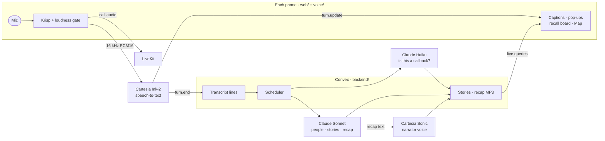

| Folder | What's in it |
| --- | --- |
| [`shared/`](shared) | `schema.ts`, the data contract every part builds against, plus the scripted Kevin conversation used for replay and tests |
| [`backend/`](backend) | Convex backend: rooms, lines, events, AI scheduling, recap, presence, rate limits |
| [`ai/`](ai) | Claude prompts, validation and the eval harness |
| [`voice/`](voice) | Mic capture, Cartesia Ink and Sonic, LiveKit call, loudness gate, turn splitter |
| [`web/`](web) | The phone web app (React + Vite) |
| [`project/`](project) | Devpost text and per-track notes |

<details>
<summary><b>How we use Cartesia</b></summary>

| Feature | How we use it |
| --- | --- |
| **Ink** (`ink-2`), turns WebSocket | One connection per phone for the whole call. `turn.update` drives live captions and the mid-sentence pop-up; `turn.end` becomes a transcript line under the speaker's name |
| **Turn detection** | Ink decides when a turn starts and ends, so there's no button. `turn_start_threshold` is 0.8 to ignore background chatter |
| **Keyterms** | Member names plus every person and alias mentioned so far, kept within Ink's limits and refreshed on reconnect |
| **Access tokens** | The backend mints a 120 s speech-to-text token for room members only. The API key never reaches the browser |
| **Sonic** (`sonic-3.6`, pinned snapshot) | Reads the recap as an MP3 in a neutral narrator voice |

</details>

<details>
<summary><b>How we use Convex</b></summary>

All of the backend is in [`backend/convex/`](backend/convex). It uses:

- **Live queries:** every phone subscribes to the room's event log, so there's no polling.
- **Mutations as transactions:** every phone sees lines in the same order.
- **Actions:** Claude, Cartesia and LiveKit calls, with keys in Convex env vars.
- **Scheduler:** runs the AI after each line and writes the recap on a late join.
- **Cron:** deletes rooms idle for 12 h.
- **File storage:** holds the recap MP3.
- **Components:** [`@convex-dev/presence`](https://www.convex.dev/components/presence) for who's still in the room, and [`@convex-dev/rate-limiter`](https://www.convex.dev/components/rate-limiter) to cap AI and voice use.

</details>

<details>
<summary><b>How we use Claude</b></summary>

| Job | Model | When |
| --- | --- | --- |
| Recall: does this line refer back to a known person or story? | Claude Haiku | Every new line |
| Story state: people, stories, keywords, real reactions, current topic | Claude Sonnet | About every 25 s |
| Recap: at most 50 words, only what this person missed | Claude Sonnet | When someone joins late |

Both return structured output through tool use. Models are `claude-haiku-5-5` and `claude-sonnet-5-5`, overridable with `AI_FAST_MODEL` / `AI_SLOW_MODEL`.

</details>

<details>
<summary><b>How the Map is drawn</b></summary>

[React Flow](https://reactflow.dev) and d3-force draw the Map straight from the people and stories Claude already tracks, so it needs no extra AI call. It refits the screen as new names come up, and once you drag or zoom, it stays where you put it. Code: [`web/src/graph/`](web/src/graph).

</details>

## What we measured

### On real phones

The final combined test on 2026-10-24 passed on the team's phones with headsets. Details are in [`voice/stage2-options.md`](voice/stage2-options.md#results-stage-2-build).

| Check | Result |
| --- | --- |
| Each turn lands under the right name, with live text on every phone | Pass |
| Two people talking at once give separate lines | Pass |
| An interruption splits the line in the right order | Pass |
| The recap ducks friends, and they don't hear it | Pass |
| Ending the room ends the call for everyone | Pass |

Not tested on real phones yet: a stranger talking 1 m away, Wi-Fi loss, phone locks mid-call, and calls past 12 minutes.

### Speech-to-text speed

`npm run ink:latency` in `voice/` has Sonic read the Kevin script and streams it to Ink-2 at real-time speed through the app's own session code.

| | Result |
| --- | --- |
| Lines transcribed correctly, names included | **6 of 6** |
| Time to open the connection | 130–680 ms, **350 ms** average (audio is queued meanwhile) |
| From end of speech to final text | **134 ms** average, plus a 300 ms tail |

These numbers come from the push-to-talk build, before the switch to an always-on call.

### Recall accuracy

`npm run eval` in `ai/` replays the Kevin conversation against Claude and compares the output with [`kevin.expected.json`](shared/fixtures/kevin.expected.json). It checks that vague references resolve to the right story ("the cake thing" → Kevin, focused on Cake; "show up at the wrong restaurant" → Kevin, focused on Airport) and that "Kevin from work" is never merged into roommate Kevin. It's one scripted conversation, so treat it as a regression check, not a benchmark.

<!-- TODO: add the latest eval pass/fail and test counts per package, from `npm test` in backend/, web/, voice/ and ai/. -->

## Run it

Needs Node 24, a [Convex](https://convex.dev) account, and keys for Anthropic, Cartesia and LiveKit. Every key lives in the Convex deployment, never in the repo or the browser.

```bash
# 1. Install (Convex bundles code from ai/ and voice/, so install those too)
(cd ai && npm install) && (cd voice && npm install) && (cd web && npm install)

# 2. Backend
cd backend && npm install
npx convex dev                     # creates a dev deployment and prints its URL
npx convex env set ANTHROPIC_API_KEY sk-ant-...
npx convex env set CARTESIA_API_KEY sk_car_...
npx convex env set LIVEKIT_URL wss://<project>.livekit.cloud
npx convex env set LIVEKIT_API_KEY ...
npx convex env set LIVEKIT_API_SECRET ...

# 3. Web app
cd ../web
echo "VITE_CONVEX_URL=<url from step 2>" > .env.local
npm run dev                        # HTTPS on https://<LAN IP>:5173 (mic needs HTTPS)
```

Open the printed address on each phone and accept the self-signed certificate. Create a room, then join from the invite link or QR code.

**Without a crowd:** `npx convex run replay:startLatest` (from `backend/`) plays the scripted Kevin conversation into the newest room.

**Missing keys:** the app still runs, just with less. Without Anthropic there are no recalls and the recap is a placeholder. Without Cartesia there's no speech-to-text, and recaps are text-only. Without LiveKit there's no call, but push-to-talk still works.

### Tests

```bash
cd backend && npm test    # convex-test, in memory
cd web && npm test        # Vitest
cd voice && npm test      # unit tests, no network
cd ai && npm test         # validation; `npm run eval` replays Kevin against Claude (needs a key)
```

More detail in each folder's README.

## Known limitations

- **English only.** Ink and Sonic are set to English.
- **Loud rooms.** Open mics can pick up a neighbor. Krisp, the loudness gate and the turn threshold help, but the gate is only unit-tested so far; earbuds help most.
- **Recap audio takes a few seconds.** The text shows first; streaming Sonic is the next step.
- **Phones.** iOS needs a tap to start audio and pauses the mic on lock; we recover with a "Tap to resume" prompt. Long calls (10+ minutes), Wi-Fi loss and phone locks mid-call aren't tested on real phones yet.
- **No accounts.** Rooms are one-off invite links that expire after 12 hours idle.

## Privacy

- Raw audio is never stored, only the transcript, and Last Sip deletes it along with the stories and recap audio.
- Everyone is told on entry that the call is transcribed, and a red dot on Mute shows whenever the mic is live.
- Every read and write is checked on the server against the caller's session.

Built at [Cal Hacks 13.0](https://calhacks.io).
